# StockPilot

A beginner-friendly stock screener for about 100 Indian stocks, with plain-English search (company names included), a built-in glossary, 52-week and 1M/3M/6M/1Y price-history metrics, "why this matched" explanations and an AI helper. A final-year CSE project at Chitkara University. Educational use only, not financial advice.

## Live demo

**[https://stockpilot-hw7d.onrender.com/](https://stockpilot-hw7d.onrender.com/)**

The app runs on free hosting that sleeps after inactivity, so the first load can take about a minute. A short "waking up" notice appears while the server starts.

## Screenshots

| | |
| --- | --- |
| 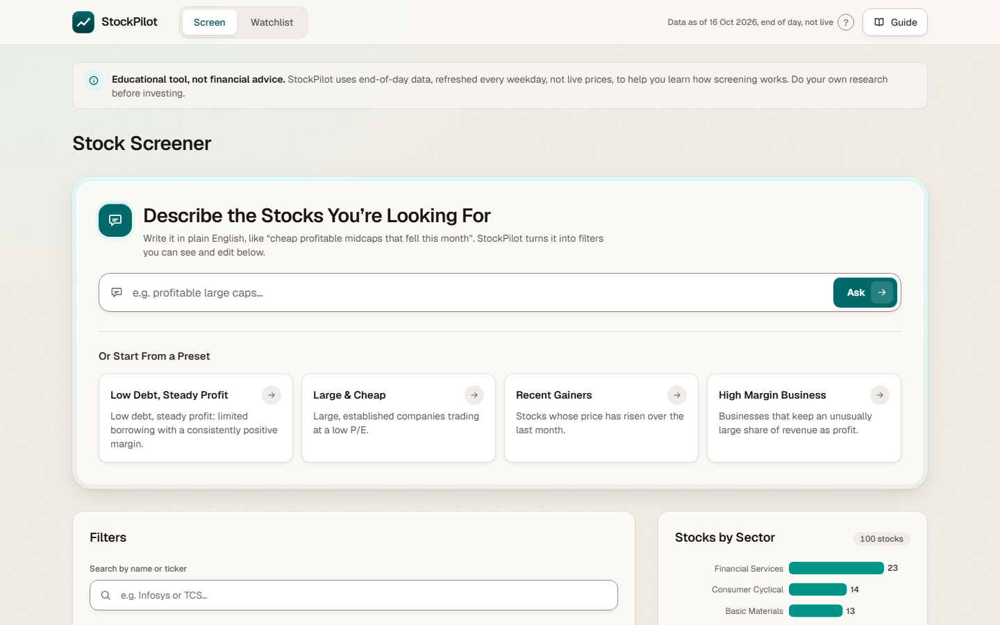 | 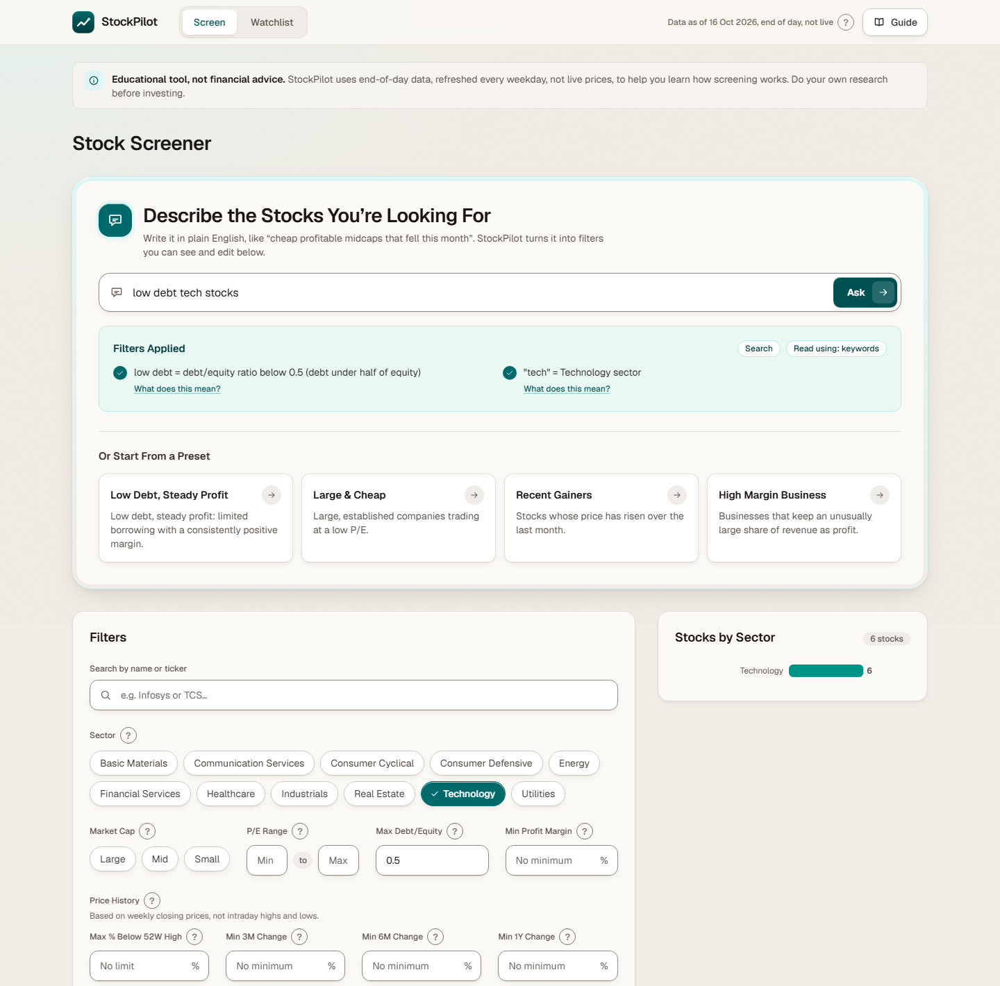 |
| **Screener.** One search box, four presets, filters and a sortable table of all 100 stocks, with the end-of-day date in the header. | **Plain-English filters.** A search becomes visible notes and removable filter chips. |
| 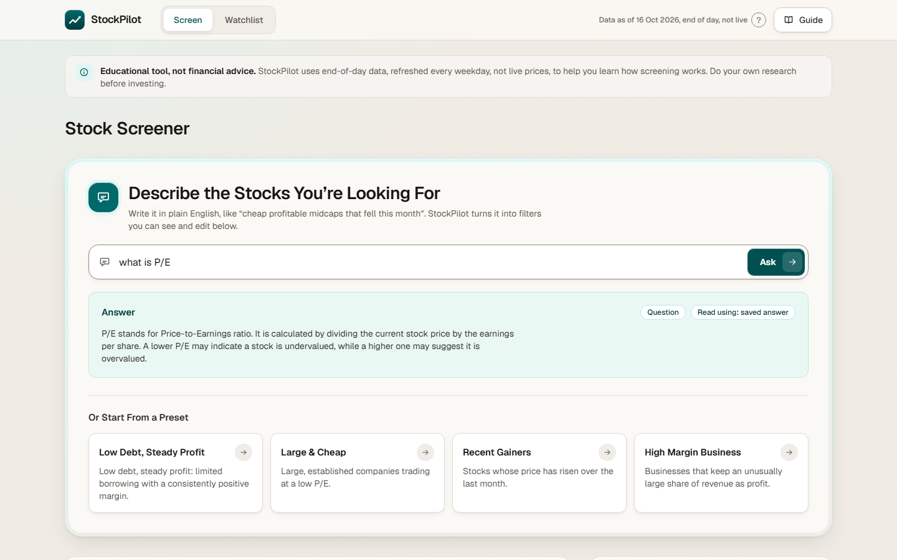 | 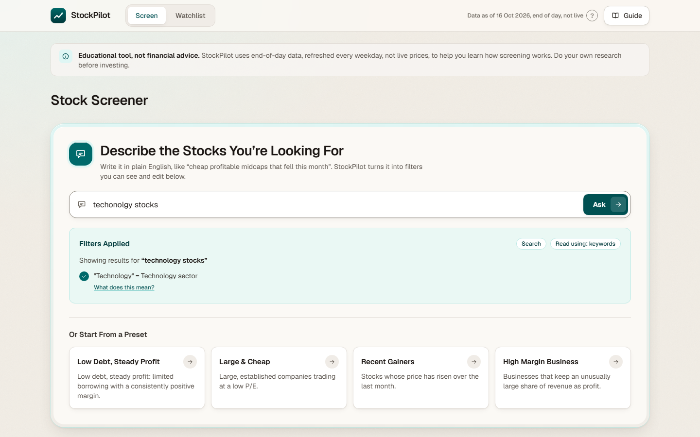 |
| **AI answer.** Questions get a short plain-text answer (this one was served from the saved-answer cache, as its label says). | **Typo tolerance.** The corrected query is shown above the filters it produced. |
| 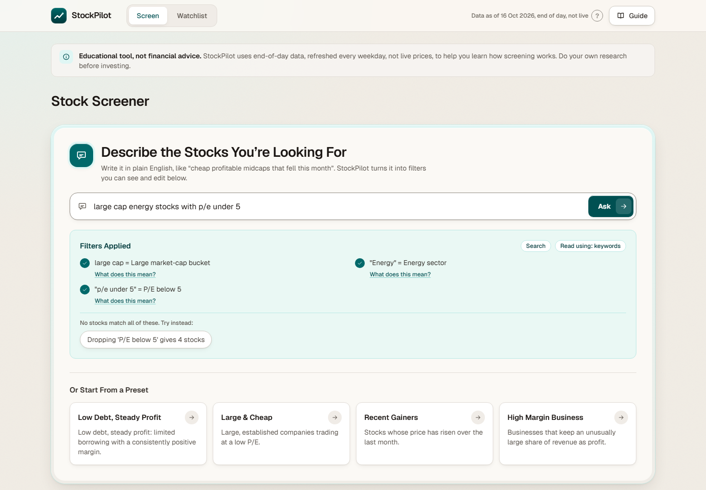 | 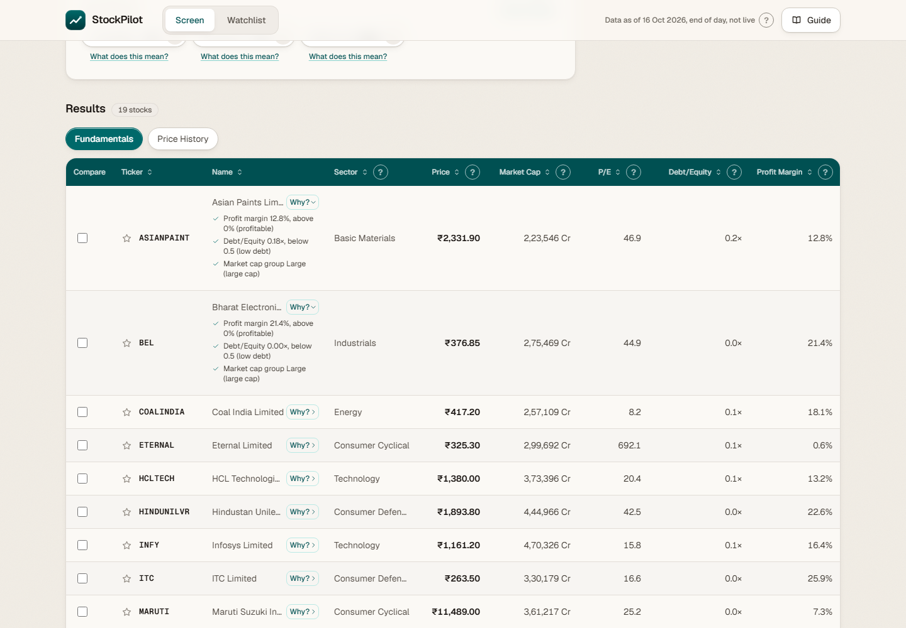 |
| **Zero-result help.** When nothing matches, one-click suggestions show which filter to drop. | **Why this matched.** Open "Why?" on a row to see, in plain words, which filters it passed and by how much. |
| 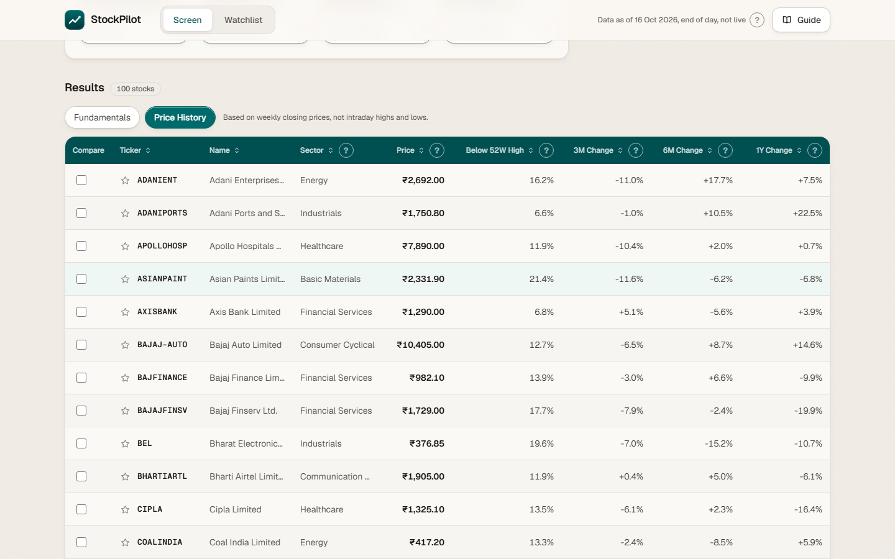 | 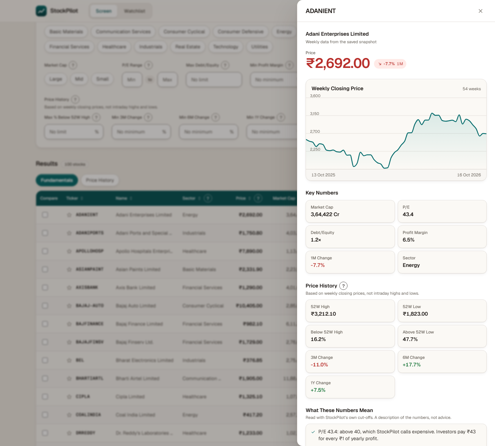 |
| **Price history.** 52-week position and 3M / 6M / 1Y change, worked out from weekly closing prices. | **Stock detail.** Weekly chart, key numbers, 52-week range and a "What These Numbers Mean" reading. |
| 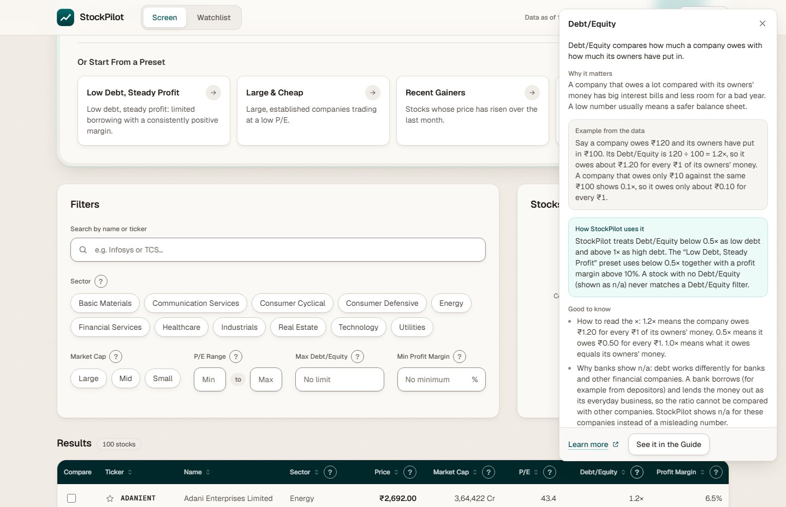 | 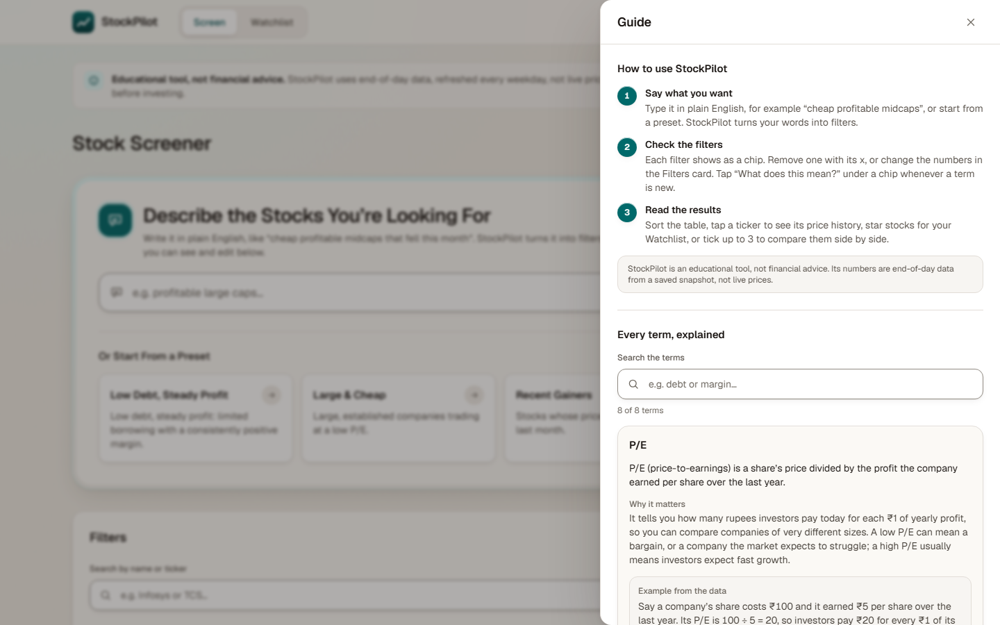 |
| **Glossary popover.** The "?" next to every metric explains it with a worked example. | **Guide.** A three-step how-to plus every term explained. |

<!-- markdownlint-disable-next-line MD033 -->
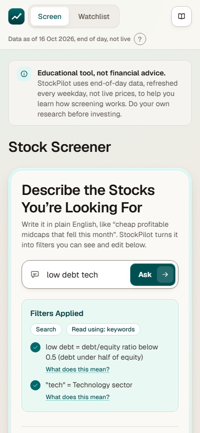

**Mobile.** The layout adapts to phone width; the table becomes stacked cards.

## What's new in v1.2.0

- **Company names in the main box.** Type "reliance", "tata motors" or "companies like Infosys" and the box searches names (a close misspelling such as "relaince" still works). "Companies like X" means X's sector only. It is the same name search as the filter below, filled in for you.
- **52-week and 1M / 3M / 6M / 1Y metrics.** 52-week high and low, how far a price sits below its high and above its low, and 3M, 6M and 1Y change. They can be filtered and sorted, and each has a glossary entry.
- **"Why this matched".** Every result row has a "Why?" that lists the filters it passed in plain words, with its real numbers.
- **"What These Numbers Mean".** The stock detail drawer reads a stock's own numbers against StockPilot's fixed cut-offs, as a description and never as advice.
- **Motion.** Rows, the price count-up, the watchlist star and the drawers now move with short, shared timings. Everything respects "reduce motion", and focus returns to where you were when a drawer closes.
- **Smaller fixes.** Preset cards toggle on and off, "Clear all filters" also clears the search box, the Compare chart no longer collapses, Esc closes only the top-most layer, and the page no longer jumps while it loads.

## What it does

- Screens about 100 stocks (NIFTY 50 + NIFTY NEXT 50) by sector, market-cap bucket, P/E, Debt/Equity, profit margin, 1-month change and, from weekly closes, 52-week position and 3M / 6M / 1Y change. Sort, paginate, star a watchlist, and compare up to 3 stocks side by side.
- Plain-English filters: type "cheap profitable midcaps that fell this month" and see it turned into filters you can read and edit. Company names work in the same box.
- Every result row can say why it matched, and the detail drawer explains the stock's own numbers.
- A beginner glossary (a "?" next to every metric) and a Guide drawer that explains each term with a worked example.
- Typo-tolerant search ("techonolgy" still works) with an AI helper for questions such as "what is P/E".
- Zero-result help: when no stock matches, StockPilot suggests which filter to drop and how many stocks that gives.

## How the data works

- **End of day, never real-time.** Prices and ratios come from Yahoo Finance through the unofficial [`yahoo-finance2`](https://www.npmjs.com/package/yahoo-finance2) package, which uses undocumented endpoints and is not a licensed data feed. The app header always shows the "Data as of" date.
- **Daily refresh.** A GitHub Actions job (`.github/workflows/ingest.yml`) runs on weekdays at 12:30 UTC, fetches every ticker and upserts it into MongoDB Atlas. A failed ticker keeps its previous data, and the "as of" date only advances if at most 10% of tickers failed.
- **Fallback.** If MongoDB is unreachable, empty or not configured, the server reads the committed snapshot `data/stocks.json` instead. `DEMO_MODE=true` skips MongoDB entirely and uses the snapshot only.
- **Stock universe.** The ticker list is hand-maintained in `server/src/data/tickers.ts` and is not updated automatically when the indices change.
- **Debt/Equity.** Shown as a ratio such as 1.2x (about Rs 1.20 of debt for every Rs 1 of owners' money). Yahoo reports it as a percentage, so we divide by 100. Banks and other financial companies show n/a because the ratio does not mean the same thing for them.

## Architecture

```text
GitHub Actions (weekdays, 12:30 UTC)
        |  fetch from Yahoo Finance, upsert
        v
MongoDB Atlas  --(fallback: data/stocks.json)-->  Render web service
                                                  Express: /api/* + built React app
                                                          |
                                                          v
                                                       Browser
```

- `server/src/data`: the only place that knows where stock data lives (`loadStocks`).
- `server/src/engine`: pure filter, sort, search, paginate and 52-week / 1Y-change functions behind `POST /api/screen`.
- `server/src/nl`: typo fixing, the rule parser, company-name matching, the LLM client and zero-result help behind `POST /api/parse`; the "why" and "what these numbers mean" text templates sit here too.
- `web/src`: the React app; `web/src/api/client.ts` is the only file that calls `fetch`.

**Stack:** TypeScript, React, Vite, Tailwind CSS, Recharts, anime.js, Express, zod, MongoDB (official driver), Vitest. Hosted on Render, data refreshed by GitHub Actions.

## The AI helper

- **Provider.** A hosted NVIDIA model, configured through `LLM_PROVIDER=nvidia`. Gemini is also supported by setting `LLM_PROVIDER=gemini`; the server uses whichever one is configured and does not switch between them on its own.
- **What it does.** It turns a search into filters, or answers a short question such as "what is P/E".
- **What it does not do.** It never sees stock data, only the text you type and the list of allowed filter fields. Its output is validated with zod and discarded if it does not fit. It is told never to recommend buying, selling or holding anything. For an advice-style question the AI writes a short educational reply itself, and the server then appends the fixed line "This is educational, not financial advice." Only that last line is fixed; the rest is model text.
- **Safeguards.** Calls are rate limited per visitor and capped per day, and answers are cached in `data/nlCache.json`. On the live site only the cache entries committed to the repo persist: Render's free disk is wiped on every restart or redeploy, so answers cached while the server runs are lost then. The committed file is currently empty, so in practice a cached answer lasts until the next restart. Every failure (timeout, quota, invalid reply) falls back to the offline keyword parser, so search always works. When the helper is unavailable the app says "AI helper is resting, showing keyword matching only."

## Run locally

Requires Node.js 22 and npm. The repo has three `package.json` files (root, `web/`, `server/`), each installed separately.

```bash
git clone https://github.com/AlfredBateman/StockPilot.git
cd StockPilot
npm install
npm install --prefix web
npm install --prefix server
cp .env.example server/.env   # the server reads server/.env
npm run dev                   # API on :3001, web on :5173
```

Environment variable names (all optional; set the values in `server/.env`, never commit them):

| Name | Purpose |
| --- | --- |
| `DEMO_MODE` | `true` runs fully offline: snapshot file only, no MongoDB, no network calls. Safest for a demo. |
| `MONGODB_URI` | MongoDB Atlas connection string. Blank means use `data/stocks.json`. |
| `LLM_PROVIDER`, `LLM_API_KEY`, `LLM_MODEL` | AI helper settings. Any blank means keyword matching only. |
| `LLM_DAILY_CAP` | Most AI calls per UTC day (default 300). |
| `PORT` | Server port (default 3001). |
| `ALLOWED_ORIGIN` | Optional CORS origin for deployments. |

Commands, run from the repo root:

| Command | What it does |
| --- | --- |
| `npm test` | Runs the web and server Vitest suites. |
| `npm run build` | Type-checks and builds both packages. |
| `npm start` | Serves the built API and frontend (what Render runs). |
| `npm run eval` | Scores the search parser on `eval/queries.json` and writes `eval/results.md`. |
| `npm run snapshot` | Re-fetches all tickers from Yahoo into `data/stocks.json`. |
| `npm run ingest`, `npm run seed`, `npm run mongo:status` | Fill and inspect MongoDB (need `MONGODB_URI`). |

## Evaluation

`eval/queries.json` holds 81 hand-written queries, each with an expected result that I wrote myself and have not independently reviewed. In `eval/results.md` the offline rule parser matches 80 of 81 expectations (99%), which mostly shows the parser does what I traced it to do, not real-world accuracy. It always answers "filter", so it gets the intent right for 66 of 81 (81%); questions, advice and off-topic queries are the ones it cannot tell apart. The AI helper section in that file is from an older 70-query run (34 of 70 matched) and was **not re-run** for v1.2.0; most of its calls hit the 8 second timeout and fell back, so it mainly measures the timeout.

## Limitations

- **Data is end of day.** Never real time, and refreshed on weekdays only, so a price can be a day or more behind.
- **The source is unofficial.** Yahoo Finance is read through the unofficial `yahoo-finance2` package, which Yahoo can change or block at any time. Some fields are missing for some stocks and show "n/a" (for example Debt/Equity for banks).
- **52-week and 3M / 6M / 1Y numbers use weekly closes**, about 54 of them, not daily prices. "52W High" is the highest weekly close, not the highest price traded, so a real intraday high or low can be missed.
- **The keyword rules cannot always tell advice from a filter.** "should I invest in small caps right now" is read by the rules as the Small cap filter. Only the AI helper can label it advice, and when it is unavailable the rules always answer "filter".
- **Some industry words search company names, not sectors.** "power" or "steel" finds companies with that word in their name, not every company in that industry, because Yahoo's sectors are too broad to map them safely.
- Free hosting sleeps after inactivity, so the first visit can take about a minute.
- The AI helper depends on a free-tier model: it can be slow, time out or run out of daily quota, and then the app uses keyword matching only. In my checks a fresh question often timed out.
- About 100 stocks only, and the list is maintained by hand.
- The keyword parser is a fixed dictionary, not general language understanding. Vague words such as "safe" or "growth" are deliberately unsupported because the data cannot define them.
- Market-cap buckets are my own thresholds calibrated to this 100-stock set, not the official SEBI rule.
- The URL does not store your filters, so a shared link opens the default view.
- Not financial advice.

## Contributors

- [@AlfredBateman](https://github.com/AlfredBateman): Team Lead and Backend Engineer
- [@sidxharthx](https://github.com/sidxharthx): QA and Database Engineer

## Disclaimer

StockPilot is a student project for learning and demonstration. It is not financial advice, nothing in it is a recommendation to buy, sell or hold any security, and the data may be late, incomplete or wrong. Do not use it to make real investment decisions.
